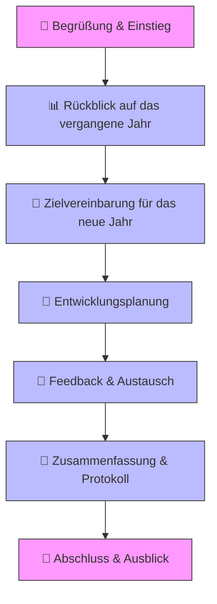
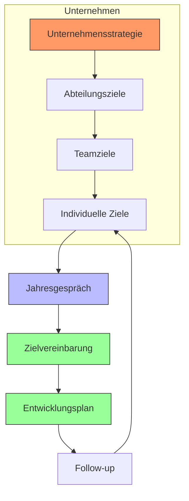

# Übersicht: Vorgehensweise bei einem Jahresgespräch mit Personal

> **Zweck:** Strukturierte Dokumentation des Ablaufs, der Ziele und der Verantwortlichkeiten für Jahresgespräche (auch: Mitarbeitergespräch, Feedbackgespräch, Zielvereinbarungsgespräch).

---

## 📌 Grundlagen

### Definition
Ein **Jahresgespräch** ist ein regelmäßiges, formelles Gespräch zwischen Führungskraft und Mitarbeiter:in, das der **Reflexion, Zielsetzung, Entwicklung und Feedbackkultur** dient. Es ist ein zentrales Instrument der **Personalführung** und **Mitarbeiterbindung**.

### Ziele
- **Rückblick:** Bewertung der Leistung und Ziele des vergangenen Jahres
- **Ausblick:** Festlegung von Zielen und Entwicklungsmaßnahmen für das kommende Jahr
- **Feedback:** Wechselseitiger Austausch über Stärken, Schwächen und Erwartungen
- **Motivation:** Wertschätzung zeigen und Perspektiven aufzeigen
- **Dokumentation:** Schriftliche Festhaltung von Vereinbarungen für Transparenz und Nachverfolgbarkeit

### Rechtliche Rahmenbedingungen (DE/AT/CH)
- **Keine gesetzliche Pflicht**, aber empfohlen (Betriebsvereinbarungen, Tarifverträge oder Unternehmensrichtlinien können es vorschreiben)
- **Dokumentation:** Schriftliche Protokolle sind sinnvoll (Datenschutz beachten!)
- **Arbeitsrecht:** Keine direkten Konsequenzen ohne weitere Schritte (z. B. Abmahnung)

---

## 📅 Vorbereitungsphase

### 👔 Für die Führungskraft

#### 1. **Terminplanung**
- **Zeitraum:** Mindestens 4–6 Wochen vor Ablauf des Bewertungszeitraums (z. B. Kalenderjahr)
- **Dauer:** 60–90 Minuten (bei komplexen Rollen ggf. länger)
- **Ort:** Neutraler, ungestörter Raum (kein Großraumbüro!)
- **Einladung:** Schriftlich (E-Mail/Kalender) mit **Agenda und Vorbereitungsaufgaben** für den Mitarbeiter

#### 2. **Dokumentenrecherche**
- **Vorjahresprotokoll:** Ziele, Vereinbarungen und Maßnahmen des letzten Jahres
- **Leistungsdaten:** Quantitative und qualitative Kennzahlen (z. B. Sales, Projektabschlüsse, Kundenfeedback)
- **Feedback:** 360°-Feedback (falls vorhanden), Teamfeedback, Kundenstimmen
- **Entwicklungsdokumente:** Schulungsnachweise, Zertifikate, Fortbildungswünsche
- **Unternehmensziele:** Strategische Ausrichtung des Teams/Unternehmens

#### 3. **Leistungsbewertung**
| **Kriterium**          | **Bewertung (1–5)** | **Beispiele/Belege** | **Kommentar** |
|------------------------|---------------------|---------------------|---------------|
| Fachliche Kompetenz   |                     |                     |               |
| Teamarbeit            |                     |                     |               |
| Eigeninitiative       |                     |                     |               |
| Zielorientierung      |                     |                     |               |
| Kommunikation          |                     |                     |               |

#### 4. **Zielvorschläge für das neue Jahr**
- **SMART-Formel** anwenden:
  - **S**pezifisch
  - **M**essbar
  - **A**ttraktiv
  - **R**ealistisch
  - **T**erminiert
- **Beispiele:**
  - "Steigerung der Kundenbefriedigung von 85% auf 90% bis Q4 2025"
  - "Abschluss der Zertifizierung XY bis 30.06.2025"

#### 5. **Entwicklungsmöglichkeiten**
- **Schulungen:** Interne/Externe Weiterbildungen
- **Projekte:** Neue Verantwortungsbereiche
- **Karrierepfad:** Mögliche nächste Schritte (z. B. Teamleitung, Fachkarriere)

---

### 👩💻 Für die:n Mitarbeiter:in

#### 1. **Selbstreflexion**
- **Leistungsnachweise:** Eigene Erfolge, Projekte, Herausforderungen sammeln
- **Zielerreichung:** Grad der Erfüllung der Vorjahresziele (mit Belegen)
- **Stärken/Schwächen:** Eigenanalyse (z. B. mit **SWOT-Matrix**)

#### 2. **Ziele und Wünsche**
- **Berufliche Ziele:** Wo möchte ich in 1–3 Jahren stehen?
- **Entwicklungswünsche:** Welche Skills möchte ich erwerben?
- **Rahmenbedingungen:** Benötige ich Unterstützung (z. B. Tools, Budget, Zeit)?

#### 3. **Feedback vorbereiten**
- **Feedback an Führungskraft:** Was läuft gut? Was könnte verbessert werden?
- **Teamfeedback:** Wie erlebe ich die Zusammenarbeit?

---

## 🗣️ Ablauf des Jahresgesprächs

### 📌 **Mermaid-Diagramm: Ablauf des Jahresgesprächs**



### 📝 **Detaillierte Phasen**

#### 1️⃣ **Begrüßung & Einstieg (5–10 Min.)**
- **Ziel:** Positiver Einstieg, Spannungen abbauen
- **Aktivitäten:**
  - Begrüßung mit Small Talk (z. B. "Wie war Ihr Wochenende?")
  - Klärung der **Agenda** und des **Zeitrahmens**
  - Betonung der **Wichtigkeit** des Gesprächs
  - Hinweis auf **Vertraulichkeit**

#### 2️⃣ **Rückblick auf das vergangene Jahr (20–25 Min.)**
- **Ziel:** Objektive Bewertung der Leistung und Zielerreichung
- **Ablauf:**
  1. **Selbstbewertung durch Mitarbeiter:in** (10 Min.)
     - "Wie schätzen Sie Ihre Leistung im letzten Jahr ein?"
     - "Welche Erfolge möchten Sie hervorheben?"
  2. **Feedback der Führungskraft** (10 Min.)
     - **Stärken** betonen (konkret mit Beispielen)
     - **Entwicklungspotenziale** konstruktiv ansprechen
     - **Zielerreichung** bewerten (mit Daten belegen)
  3. **Gemeinsame Diskussion** (5 Min.)
     - Unterschiedliche Perspektiven klären
     - Missverständnisse ausräumen

#### 3️⃣ **Zielvereinbarung für das neue Jahr (20 Min.)**
- **Ziel:** Klare, messbare Ziele für das kommende Jahr festlegen
- **Methode:** **SMART-Ziele**
- **Beispiel-Dialog:**
  - Führungskraft: "Welche Ziele möchten Sie für das nächste Jahr setzen?"
  - Mitarbeiter:in: "Ich möchte meine Projektleitungskompetenz ausbauen."
  - Führungskraft: "Wie könnte das konkret aussehen?" → **SMART-Formulierung**
- **Dokumentation:** Ziele schriftlich festhalten (z. B. in einer **Zielvereinbarung**)

#### 4️⃣ **Entwicklungsplanung (15 Min.)**
- **Ziel:** Individuelle Entwicklungsmaßnahmen identifizieren
- **Fragen:**
  - "Welche Skills möchten Sie weiterentwickeln?"
  - "Brauchen Sie Unterstützung bei der Zielerreichung?"
  - "Welche Ressourcen (Budget, Zeit, Tools) benötigen Sie?"
- **Mögliche Maßnahmen:**
  - Schulungen (intern/extern)
  - Mentoring/Coaching
  - Projektverantwortung
  - Job Rotation

#### 5️⃣ **Feedback & Austausch (10–15 Min.)**
- **Ziel:** Wechselseitiges Feedback geben und annehmen
- **Regeln für konstruktives Feedback:**
  - **Sachlich** (keine persönlichen Angriffe)
  - **Konkrete Beispiele** nennen
  - **Lösungsorientiert** (nicht nur Kritik, sondern auch Vorschläge)
- **Feedback der Führungskraft an Mitarbeiter:in:**
  - "Ich schätze besonders, wie Sie..."
  - "Für die Zukunft wünsche ich mir, dass Sie..."
- **Feedback der Mitarbeiter:in an Führungskraft:**
  - "Ich fühle mich gut unterstützt bei..."
  - "Ich wünsche mir mehr/weniger..."

#### 6️⃣ **Zusammenfassung & Protokoll (5–10 Min.)**
- **Ziel:** Vereinbarungen schriftlich festhalten
- **Inhalte des Protokolls:**
  - **Zusammenfassung der Bewertung** (Stärken, Potenziale)
  - **Vereinbarte Ziele** (SMART-formuliert)
  - **Entwicklungsmaßnahmen** (mit Verantwortlichen und Terminen)
  - **Feedback-Punkte** (beider Seiten)
  - **Nächste Schritte** (Wer macht was bis wann?)
- **Unterschriften:** Beide Seiten bestätigen die Richtigkeit

#### 7️⃣ **Abschluss & Ausblick (5 Min.)**
- **Ziel:** Positiver Abschluss und Motivation
- **Aktivitäten:**
  - Dank für das Gespräch
  - Betonung der **Wertschätzung**
  - Ausblick auf die **Zusammenarbeit im neuen Jahr**
  - Klärung des **Follow-up** (z. B. Quartalschecks)

---

## 📄 Dokumentation & Nachbereitung

### **Protokollvorlage**

```markdown
# Protokoll: Jahresgespräch
**Datum:** [TT.MM.JJJJ]
**Mitarbeiter:in:** [Name]
**Führungskraft:** [Name]
**Abteilung:** [Abteilung]

---

## 1. Rückblick auf [Jahr]
### 1.1 Selbstbewertung der Mitarbeiter:in
- [ ] 

### 1.2 Bewertung durch Führungskraft
| **Kriterium**       | **Bewertung (1–5)** | **Kommentar** |
|---------------------|---------------------|---------------|
| Fachliche Kompetenz|                     |               |
| Teamarbeit          |                     |               |
| ...                 |                     |               |

### 1.3 Gemeinsame Einschätzung
- **Stärken:** 
- **Entwicklungspotenziale:** 

---

## 2. Zielvereinbarungen für [nächstes Jahr]
| **Ziel** | **Messkriterium** | **Verantwortlich** | **Termin** | **Status** |
|----------|-------------------|--------------------|------------|------------|
|          |                   |                    |            |            |

---

## 3. Entwicklungsmaßnahmen
| **Maßnahme** | **Art** (Schulung/Projekt/etc.) | **Verantwortlich** | **Termin** | **Kosten** |
|--------------|----------------------------------|--------------------|------------|------------|
|              |                                  |                    |            |            |

---

## 4. Feedback
### 4.1 Feedback der Führungskraft an Mitarbeiter:in
- **Positiv:** 
- **Konstruktiv:** 

### 4.2 Feedback der Mitarbeiter:in an Führungskraft
- **Positiv:** 
- **Konstruktiv:** 

---

## 5. Nächste Schritte
- [ ] Protokoll bis [Datum] unterzeichnen
- [ ] Entwicklungsmaßnahmen bis [Datum] planen
- [ ] Follow-up-Gespräch am [Datum]

---

**Unterschriften:**
_________________________ (Mitarbeiter:in)
_________________________ (Führungskraft)
```

### **Nachbereitung durch die Führungskraft**
1. **Protokoll finalisieren** und an Mitarbeiter:in senden (innerhalb von 1 Woche)
2. **Maßnahmen umsetzen:**
   - Schulungen buchen
   - Budgets freigeben
   - Projekte zuweisen
3. **Follow-up planen:**
   - Quartalschecks (z. B. nach 3, 6, 9 Monaten)
   - Regelmäßige Feedbackgespräche
4. **Dokumentation:**
   - Protokoll in der **Personalakte** ablegen
   - Ziele in **HR-Software** eintragen (falls vorhanden)

### **Nachbereitung durch die:n Mitarbeiter:in**
1. **Protokoll prüfen** und bei Bedarf korrigieren
2. **Ziele und Maßnahmen** in eigenen Kalender/To-dos übernehmen
3. **Entwicklungsplan** umsetzen (z. B. Schulungen buchen)

---

## 🎯 Methoden & Tools

### **Bewertungsmethoden**
| **Methode**               | **Beschreibung** | **Vorteil** | **Nachteil** |
|---------------------------|------------------|-------------|--------------|
| **360°-Feedback**         | Feedback von Kollegen, Vorgesetzten, Untergebenen | Ganzheitliche Sicht | Aufwendig |
| **BSC (Balanced Scorecard)** | Bewertung nach Finanz-, Kunden-, Prozess- und Lernperspektive | Strategieorientiert | Komplex |
| **KPIs (Key Performance Indicators)** | Messbare Kennzahlen (z. B. Umsatz, Qualität) | Objektiv | Einseitig |
| **Kompetenzmatrix**       | Bewertung von Skills auf einer Skala | Transparent | Subjektiv |

### **Feedback-Methoden**
| **Methode**               | **Beschreibung** | **Beispiel** |
|---------------------------|------------------|--------------|
| **Sandwich-Methode**      | Positiv → Kritik → Positiv | "Ihre Präsentation war gut strukturiert (Positiv). Beim nächsten Mal mehr Interaktion einbauen (Kritik). Insgesamt eine starke Leistung! (Positiv)" |
| **SBI-Methode**           | **S**ituation, **B**ehavior, **I**mpact | "In der Besprechung gestern (Situation) haben Sie die Diskussion dominiert (Behavior). Dadurch kamen andere nicht zu Wort (Impact)." |
| **Stop-Start-Continue**   | Was soll aufhören/beginnen/weitergehen? | "Stop: Mikromanagement. Start: Mehr Delegation. Continue: Regelmäßige Updates." |

### **Zielsetzungsmethoden**
| **Methode**               | **Beschreibung** | **Beispiel** |
|---------------------------|------------------|--------------|
| **SMART**                 | Spezifisch, Messbar, Attraktiv, Realistisch, Terminiert | "Steigerung der Verkaufszahlen um 10% bis Q4 2025" |
| **OKR (Objectives & Key Results)** | Ambitionierte Ziele + messbare Ergebnisse | **Objective:** Marktführer werden. **Key Result:** Marktanteil von 20% auf 25% steigern. |
| **MBO (Management by Objectives)** | Ziele werden gemeinsam vereinbart und regelmäßig überprüft | Quartalsweise Zielüberprüfung |

---

## 📊 Mermaid-Diagramm: Jahresgespräch im Unternehmenskontext



---

## ✅ Checklisten

### **Checkliste für Führungskräfte**
- [ ] Termin rechtzeitig geplant (4–6 Wochen vorher)
- [ ] Einladung mit Agenda und Vorbereitungsaufgaben verschickt
- [ ] Vorjahresprotokoll und Leistungsdaten gesichtet
- [ ] Ziele und Entwicklungsvorschläge vorbereitet
- [ ] Raum gebucht (neutral, ungestört)
- [ ] Protokollvorlage bereitgehalten
- [ ] Nachbereitung: Protokoll finalisiert und Maßnahmen umgesetzt

### **Checkliste für Mitarbeiter:innen**
- [ ] Selbstreflexion durchgeführt (Erfolge, Herausforderungen)
- [ ] Vorjahresziele auf Erfüllung geprüft
- [ ] Eigene Ziele und Entwicklungswünsche formuliert
- [ ] Feedback für Führungskraft vorbereitet
- [ ] Fragen und Anliegen notiert
- [ ] Protokoll geprüft und unterzeichnet

---

## 🚨 Häufige Fehler & wie man sie vermeidet

| **Fehler** | **Auswirkung** | **Lösung** |
|------------|----------------|------------|
| **Keine Vorbereitung** | Oberflächliches Gespräch, unklare Ziele | Checklisten nutzen, Zeit einplanen |
| **Zu kritisch/negativ** | Demotivation, Vertrauensverlust | Stärken betonen, konstruktives Feedback geben |
| **Keine konkreten Ziele** | Keine Messbarkeit, keine Verantwortung | SMART-Ziele vereinbaren |
| **Kein Follow-up** | Ziele werden nicht umgesetzt | Regelmäßige Check-ins planen |
| **Einseitiges Gespräch** | Mitarbeiter:in fühlt sich nicht gehört | Aktives Zuhören, Fragen stellen |
| **Zu kurz/überstürzt** | Wichtige Themen werden nicht besprochen | Mindestens 60–90 Minuten einplanen |
| **Keine Dokumentation** | Keine Nachverfolgbarkeit | Protokoll anfertigen und unterzeichnen |

---

## 📚 Weiterführende Ressourcen

### **Bücher**
- "Das neue Jahresgespräch" – *Jürgen Hargens*
- "Feedback geben – aber richtig!" – *Johannes Fawcett*
- "Ziele setzen und erreichen" – *Brian Tracy*

### **Tools & Software**
- **HR-Software:** Personio, BambooHR, SAP SuccessFactors
- **Zielmanagement:** Asana, Trello, Monday.com
- **Feedback-Tools:** 15Five, Lattice, Officevibe

### **Vorlagen & Downloads**
- [Protokollvorlage (Word)](https://example.com)
- [SMART-Zielvorlage (Excel)](https://example.com)
- [360°-Feedback-Bogen (PDF)](https://example.com)

---

## 🔄 Follow-up & Kontinuierliche Verbesserung

### **Regelmäßige Check-ins**
- **Quartalsgespräche:** Kurze Updates zu Zielen und Fortschritten
- **Monatliche 1:1s:** Informeller Austausch, schnelles Feedback
- **Ad-hoc-Feedback:** Spontane Anerkennung oder konstruktive Hinweise

### **Evaluierung des Jahresgesprächs**
- **Feedback zum Gespräch:**
  - "Wie haben Sie das Gespräch erlebt?"
  - "Was war hilfreich? Was könnte besser sein?"
- **Anpassung des Formats:**
  - Dauer, Struktur, Methoden anpassen
  - Neue Tools oder Vorlagen einführen

### **Best Practices**
✅ **Regelmäßigkeit:** Jährlich durchführen (ideal: immer zur gleichen Zeit)
✅ **Transparenz:** Klare Kriterien und Bewertungsmethoden kommunizieren
✅ **Partizipation:** Mitarbeiter:in aktiv einbinden (Selbstbewertung, Zielvorschläge)
✅ **Dokumentation:** Alles schriftlich festhalten
✅ **Follow-up:** Vereinbarungen nachverfolgen

---

## 📌 Zusammenfassung

| **Phase** | **Dauer** | **Verantwortlich** | **Wichtigster Output** |
|-----------|-----------|--------------------|------------------------|
| Vorbereitung | 2–4 Wochen | Führungskraft & Mitarbeiter:in | Unterlagen, Ziele, Feedback |
| Gespräch | 60–90 Min. | Beide | Vereinbarungen, Protokoll |
| Nachbereitung | 1–2 Wochen | Führungskraft | Umgesetzte Maßnahmen, Follow-up |

**Erfolgsfaktoren:**
🔹 **Vorbereitung ist alles** – Je besser vorbereitet, desto produktiver das Gespräch.
🔹 **Dialog statt Monolog** – Beide Seiten sollten gleichberechtigt zu Wort kommen.
🔹 **Konkrete Ergebnisse** – Klare Ziele und Maßnahmen vereinbaren.
🔹 **Nachhaltigkeit** – Follow-up sichern, um die Umsetzung zu gewährleisten.

---

*Diese Übersicht dient als Leitfaden und kann an die spezifischen Anforderungen Ihres Unternehmens angepasst werden.*
